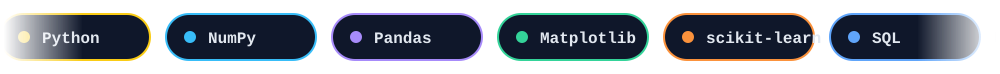
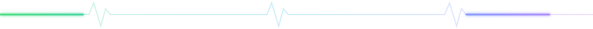

  

  

## 🧑‍💻 About Me

  

- 🚀 Passionate **Python Developer** & **Data Science Enthusiast**
- 🌱 Currently exploring **DSA, Machine Learning & Frontend Development**
- ⚡ Love solving **real-world problems** using code
- 📈 Interested in data-driven decision making and analytics

## 🛠️ Skills & Tech Stack

### 🚀 Languages

  

### 📚 Libraries & Tools

  
  
  
  
  

- **Machine Learning:** scikit-learn
- **Database:** SQL

## 🌐 Connect with Me

  
  
  

✨ <b>"Code. Learn. Analyze. Innovate."</b> 🚀

